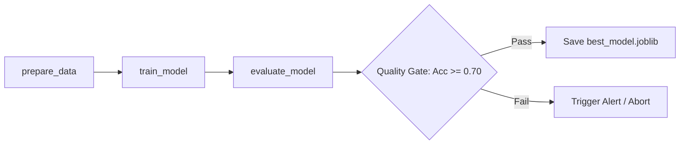

# 🎓 Student Mental Health & Well-Being Support System

> **A Supervised Machine Learning Pipeline & Interactive Decision Support Prototype for Academic Guidance Teams.**

---

## 📌 Project Links & Governance

* 📋 **Jira Project Management Board:** [Atlassian Jira Board](https://kimad7141-1791453020439.atlassian.net/jira/software/projects/MD/boards/36?filter=&groupBy=none&atlOrigin=eyJpIjoiMTFiYWUyZjFjODY3NGExY2JhNGExMDUzMWIyMTA2NGUiLCJwIjoiaiJ9)
* 🎨 **Canva Presentation Slides:** [Canva Interactive Deck](https://canva.link/colra7hvp4rgtz8)
* 📊 **Local Presentation File:** [Download Presentation Slides (.pptx)](presentation/mental_health_presentation.pptx)

---

## ⚠️ Mandatory Ethical & Pedagogical Notice

> [!WARNING]
> **Strictly Pedagogical & Supportive Purpose:** This project and its predictive model are developed solely for educational and academic support within an educational institution. The system is designed to assist student advisors and support staff in prioritizing guidance resources.  
> **It is NOT a medical diagnosis tool, psychiatric screening system, disciplinary instrument, or student selection filter.** All outputs must involve human review and ethical oversight.

---

## 🎯 Business & Academic Objectives

* **Early Risk Detection:** Identify students experiencing elevated academic, environmental, or psychological strain.
* **Proactive Prevention:** Anticipate support needs before severe academic decline or distress occurs.
* **Factor Understanding:** Uncover key lifestyle and academic drivers (sleep deprivation, financial stress, screen time) that correlate with student vulnerability.
* **Resource Guidance:** Direct students to appropriate university resources (academic tutoring, financial aid, wellness workshops, counseling).

---

## 📂 Repository Structure

```text
├── app/
│   └── app.py                     # Interactive Streamlit dashboard & prediction app
├── dags/
│   └── mental_health_dag.py       # Airflow DAG orchestrating data, training & evaluation
├── data/
│   ├── student_mental_health.csv  # Original raw dataset (2,000 records)
│   ├── train.csv                  # 80% stratified training set
│   └── test.csv                   # 20% unseen test set
├── models/
│   └── best_model.joblib          # Serialized production pipeline (preprocessor + model)
├── notebooks/
│   ├── explorations.ipynb         # Étape 1: Exploratory Data Analysis (EDA)
│   ├── preparation.ipynb          # Étape 2: Preprocessing, imputation & outlier audit
│   └── training.ipynb             # Étape 3 & 4: Model comparison, GridSearchCV & evaluation
├── src/
│   ├── __init__.py
│   ├── preprocessing.py           # Preprocessing pipeline construction & data loading
│   └── pipeline.py                # Standalone functions for training, evaluation & quality gate
├── presentation/
│   └── mental_health_presentation.pptx # Project defense presentation slides
├── .gitignore                     # Git tracking exclusions
├── README.md                      # Project documentation
└── requirements.txt               # Python package dependencies
```

---

## 🔬 Methodology & Technical Approach

### 1. Exploratory Data Analysis (EDA)
* **Dataset:** 2,000 rows, 17 attributes; zero missing values in primary features, no duplicate records.
* **Target:** `Mental_Health_Risk` with 3 balanced classes:
  * Low Risk: ~33%
  * Medium Risk: ~33%
  * High Risk: ~34%
* **Key Risk Factors Identified:** Low sleep hours (< 6h), high academic pressure/study strain, high financial stress, and excessive daily screen time strongly associate with elevated risk levels.

### 2. Preprocessing & Zero-Leakage Pipeline
* **Split:** 80% training (1,600 students) and 20% test (400 students) with target stratification.
* **Outlier Strategy:** Outliers in study and sleep hours represent genuine human behaviors rather than corruption. Kept all data and used **`RobustScaler`** (median and IQR-based scaling) to neutralize outlier leverage.
* **Categorical Encoding:** `OneHotEncoder(handle_unknown='ignore')` for multi-category features.
* **Encapsulation:** All transformations wrapped in a Scikit-Learn `ColumnTransformer` inside an end-to-end `Pipeline`.

### 3. Model Training & Comparison (Baselines)
Trained three candidate algorithms on identical training folds:
1. **Logistic Regression** (Linear baseline)
2. **Random Forest Classifier** (Bagging ensemble)
3. **Gradient Boosting Classifier** (Boosting ensemble)

### 4. Hyperparameter Optimization (`GridSearchCV`) & Results
Conducted 5-fold Stratified Cross-Validation across candidate models:

| Model | CV Score | Test Accuracy | Test F1-Score | Test ROC-AUC | Best Hyperparameters |
| :--- | :---: | :---: | :---: | :---: | :--- |
| **Logistic Regression** (Selected) | **75.44%** | **75.50%** | **75.48%** | **0.9137** | `{'C': 1.0, 'solver': 'lbfgs'}` |
| **Gradient Boosting** | 69.69% | 71.00% | 70.79% | 0.8828 | `{'learning_rate': 0.1, 'max_depth': 3}` |
| **Random Forest** | 69.50% | 70.50% | 70.16% | 0.8667 | `{'max_depth': 10, 'n_estimators': 200}` |

#### Why Logistic Regression Won:
* Highest generalization accuracy and multi-class discriminatory power (**ROC-AUC: 0.9137**).
* **High-Risk Class Recall = 82.4%**: Accurately flags over 8 out of 10 high-risk students on unseen data.
* Full transparency and interpretability for academic ethics committees.

---

## ⚙️ Orchestration & Automated Pipeline (Airflow)

The pipeline is automated using Apache Airflow (`dags/mental_health_dag.py`):


* **`prepare_data`**: Loads raw data, splits stratified train/test sets, and stores intermediate CSV files.
* **`train_model`**: Assembles the end-to-end `Pipeline` and fits it strictly on training data.
* **`evaluate_model`**: Evaluates on test data and executes an automated **Quality Gate** (`acc >= 0.70`).

---

## 💻 Interactive Streamlit Application

The interactive web dashboard (`app/app.py`) provides:
1. **Interactive Risk Assessment:** Input academic, sleep, routine, and psychological indicators to receive real-time risk predictions with class probabilities and actionable guidance suggestions.
2. **Performance Monitoring:** Inspect test set metrics, class-level classification reports, and interactive confusion matrices.
3. **Ethics & Methodology Reference:** In-app access to governance policies and ethical guidelines.

---

## 🚀 Installation & Getting Started

### 1. Clone Repository & Setup Virtual Environment
```bash
# Clone the repository
git clone <your-repo-url>
cd mental_health_detection

# Create and activate virtual environment
python3 -m venv .venv
source .venv/bin/activate

# Install dependencies
pip install -r requirements.txt
```

### 2. Run the Streamlit Application
```bash
streamlit run app/app.py
```
Open your browser at `http://localhost:8501`.

### 3. Run the Pipeline Standalone
You can execute the full data and training pipeline independently:
```bash
python3 -c "from src.pipeline import prepare_data, train_model, evaluate_model; prepare_data(); train_model(); evaluate_model()"
```

---

## 👥 Contributors & Academic Context

* **Project:** Academic Student Mental Health Detection Prototype (Jury Blanc)
* **Date:** November 2026
* **Status:** Complete & Ready for Defense
